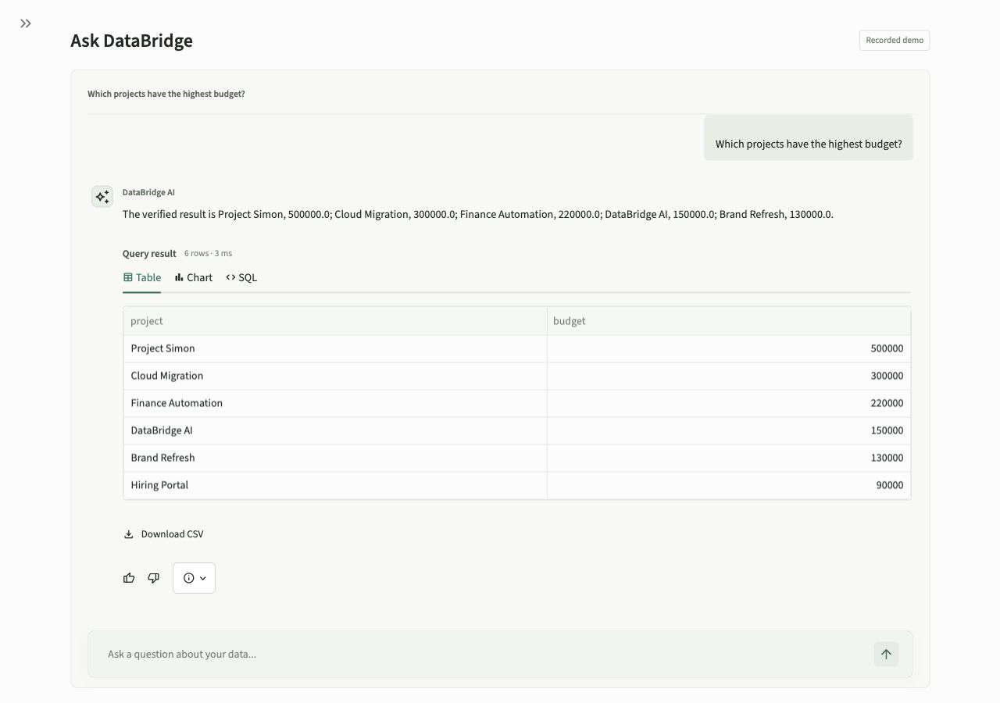
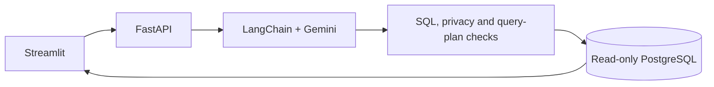

# DataBridge AI

A local, read-only interface for asking PostgreSQL questions in English or German.
Get a verified result, inspect its SQL, and explore the data as a table or chart.

[](https://github.com/idevelopAI/databridge-ai/actions/workflows/ci.yml)
[Setup](docs/setup.md) · [API](docs/reference.md) · [Screenshots](docs/interface.md) · [Security](SECURITY.md)



## Try It Locally

Requires Docker Desktop with Compose. The included demo uses synthetic data and
recorded queries, so it needs **no API key and makes no model calls**.

```bash
git clone https://github.com/idevelopAI/databridge-ai.git
cd databridge-ai
./scripts/demo.sh
```

Open [localhost:8601](http://localhost:8601) and select a suggested question.
Stop the demo with `./scripts/demo.sh down`.

## Live Mode

1. Copy `.env.example` to `.env`.
2. Set `GOOGLE_API_KEY` and replace each `replace_me` password/token with a
   unique random value (`openssl rand -hex 32`).
3. Run `docker compose up -d --build` and open
   [localhost:8501](http://localhost:8501).

Keep `.env` private. Live mode sends questions, allowed schema metadata, SQL, and
policy-filtered results to Gemini. Model-provider usage may incur charges.

## What It Does

- **Ask and clarify:** bilingual questions, follow-up clarification, and session-local chats.
- **Inspect results:** tables, charts, CSV downloads, SQL, and query feedback.
- **Understand your schema:** searchable tables, a business glossary, and guided
  PostgreSQL onboarding with schema/column validation.
- **Control access:** table/column policies, sensitive-value masking, read-only
  transactions, query-plan limits, and bounded results.
- **Operate locally:** Docker Compose, readiness checks, privacy-safe metrics,
  automated tests, and a reproducible no-key demo.

## How It Works



Recorded mode replaces Gemini with verified SQL fixtures while keeping the real
database and query controls. [Architecture and API details](docs/reference.md).

## Verification

| Check | Result |
| --- | --- |
| Recorded result equivalence | 40/40 |
| Unsafe-query rejection | 12/12 |
| Live model accuracy | Not measured |
| Automated tests | 152 passing |
| CI | Python 3.11–3.13, coverage, dependency audit, containers |

Recorded results validate the application workflow; they are **not an LLM accuracy
score**. See the [evaluation guide](docs/evaluation.md) and
[committed report](evaluation/recorded-report.json) for methodology and timings.

## Documentation

| Guide | Contents |
| --- | --- |
| [Setup and configuration](docs/setup.md) | Installation, database onboarding, glossary, privacy rules |
| [API and security reference](docs/reference.md) | Endpoints, query controls, metrics, feedback storage |
| [Development and releases](docs/development.md) | Tests, coverage, container artifacts, SBOMs |
| [Evaluation](docs/evaluation.md) | Recorded and opt-in live evaluation |
| [Interface](docs/interface.md) | Screenshots and demo walkthrough |
| [Architecture decisions](docs/adr/README.md) | SQL safety, query-plan gating, observability |

The stack binds to localhost and is intended for a trusted local machine.
Read [SECURITY.md](SECURITY.md) before connecting confidential data.

[Contributing](CONTRIBUTING.md) · [Changelog](CHANGELOG.md) · [MIT license](LICENSE)
