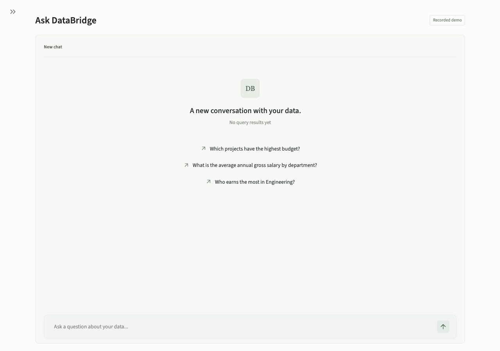
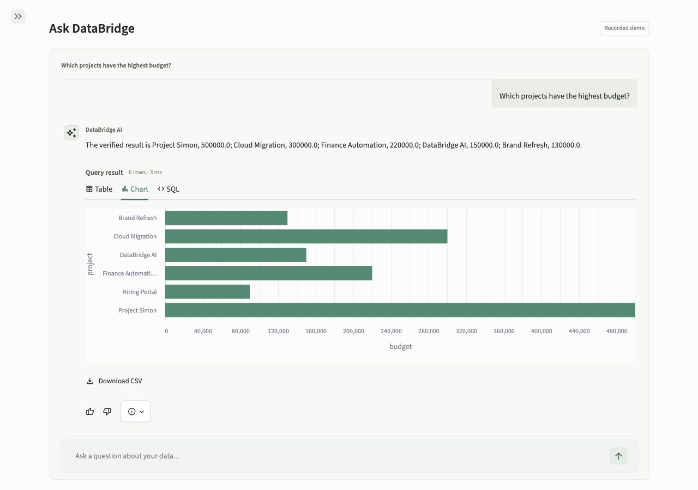
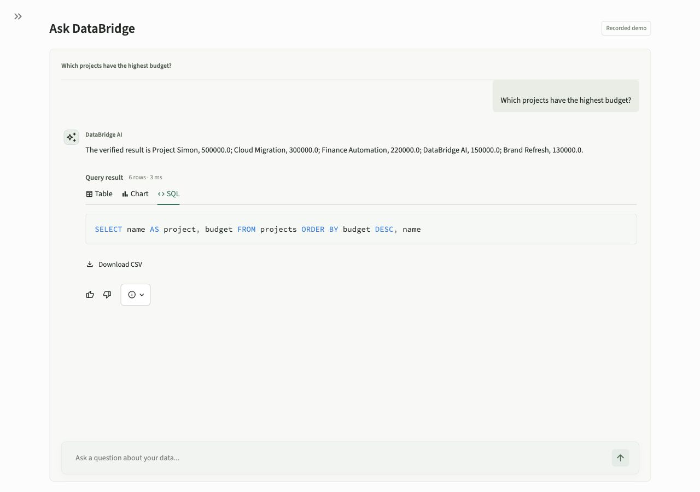
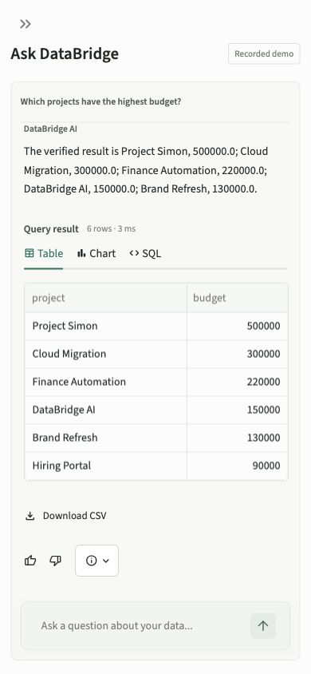

# Interface

[Back to the README](../README.md)

These screenshots use the included synthetic database in recorded mode. No model
API call or real record is needed to reproduce them.

## Query Workspace

Suggested questions appear in an empty chat; recent chats live in the sidebar.
The conversation uses the main workspace. Chats remain in
the current browser session, with up to twelve conversations retained. New chat
starts an independent context; reopening an existing chat does not rerun its SQL.

## Results and Charts

Tables, charts, and generated SQL are available directly in each answer. CSV
exports and correct/incorrect feedback belong to the same result.

## SQL Inspection

## Mobile

The conversation adapts to smaller screens. Database navigation remains
available through the sidebar toggle.

## Reproduce

Start `./scripts/demo.sh`, open `http://localhost:8601`, select English, and ask
"Which projects have the highest budget?". Switch between Table, Chart, and SQL.
For a clarification, ask "Who earns the most in Engineering?" and reply "Annual
gross salary". The composer remains available after the clarification, and the
salary result is masked. Mark the result correct or incorrect to save the original
question and clarification together as local feedback.

Ask "Delete all employees." to verify that unsafe requests are rejected. Stop
the isolated demo with `./scripts/demo.sh down`.
