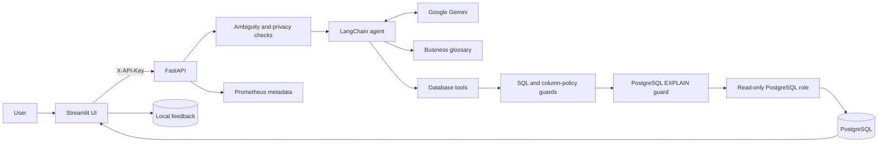

# API and Security Reference

[Back to the README](../README.md)

## Architecture



The included database contains synthetic departments, employees, and projects so
the full workflow is usable immediately.

## API

The browser UI is the primary interface. The backend can also be called directly:

```bash
curl --request POST http://localhost:8000/api/v1/query \
  --header "Content-Type: application/json" \
  --header "X-API-Key: $APP_SECRET_TOKEN" \
  --data '{"question":"What is the average annual gross salary by department?","language":"en"}'
```

Successful responses require at least one accepted SQL execution and include the
natural-language answer, every executed SQL statement, structured rows,
truncation state, request ID, model duration, tool-call count, and
provider-reported token usage. Ambiguous questions return
`clarification_required` without calling the model. Schema metadata is available
from `GET /api/v1/schema` with the same API key.

Validated business definitions are available from `GET /api/v1/glossary`. The
agent receives only glossary entries matched to the current question and can use
the full glossary through a dedicated read-only tool.

The authenticated API also provides `GET /api/v1/privacy`,
`POST /api/v1/feedback`, `GET /api/v1/feedback/export`, and `GET /metrics`.

## Observability

Every HTTP response includes `X-Request-ID`. The query response also includes
model latency, tool-call count, SQL timing, and input/output token counts when the
provider reports them. Authenticated Prometheus metrics are available with:

```bash
curl --silent http://localhost:8000/metrics \
  --header "X-API-Key: $APP_SECRET_TOKEN"
```

Metrics cover request outcomes and duration, model duration and tokens, tool-call
outcomes, SQL duration, rejection reason codes, and feedback ratings. Metric
labels are bounded and never contain request IDs, prompts, SQL, credentials, tool
arguments, or rows. Structured events contain only request ID and numeric or
enumerated metadata. Keep `AGENT_VERBOSE=false`; framework debug output is not a
privacy-safe telemetry channel.

This follows the OpenTelemetry GenAI guidance to collect model, token, duration,
and tool metadata while leaving content capture disabled by default. See
[OpenTelemetry GenAI observability](https://opentelemetry.io/blog/2026/genai-observability/).

## Query Feedback

Answered queries provide **Correct** and **Incorrect** controls. A rating stores
exactly the question, final accepted SQL, and feedback value in a local SQLite
file with mode `0600`. Answers, database rows, credentials, prompts without a
rating, and telemetry are not persisted in the feedback database.

For clarified requests, the question includes the original question and accepted
user clarification replies. Unrelated conversation turns, clarification messages
from the assistant, and rejected requests are excluded. The combined question is
limited to 5,000 characters; longer clarification chains cannot be rated rather
than being silently truncated.

The backend stores feedback in the `feedback_data` Docker volume. Export reviewed
examples from the sidebar or `GET /api/v1/feedback/export`; the JSONL export is
suitable for review and later evaluation-dataset curation. `FEEDBACK_DB_PATH`
changes the local storage path.

## Security Model

DataBridge AI uses several independent controls:

1. The backend accepts one authenticated request token and compares it in constant
   time.
2. SQL is parsed as PostgreSQL and must contain exactly one read-only query.
3. Questions and generated SQL must pass independent table and column policy
   checks; direct sensitive outputs are masked before reaching the model or UI.
4. Accepted SQL must pass configurable PostgreSQL query-plan limits before it can
   execute.
5. Every PostgreSQL execution uses a read-only transaction with a local statement
   timeout, in addition to the agent role's `SELECT` privileges and role defaults.
6. Query rows, individual cells, and total serialized result bytes are capped
   before data is returned to the agent or UI.
7. Database and plan errors are converted to generic messages before they reach
   the model or browser.
8. Metrics and structured events omit prompts, SQL, credentials, and returned
   rows by default.
9. Services bind to `127.0.0.1` by default, and containers run as non-root users
   where applicable.

Questions, allowed schema metadata, generated SQL, and policy-filtered rows are
sent to the configured model provider while answering a request. Review
data-handling requirements before connecting confidential data. The feedback
database deliberately stores reviewed questions and SQL locally; protect and
delete that volume according to the data's sensitivity.

The API token is service-to-service protection for local use, not a multi-user
identity system. Do not expose this stack directly to the internet. Add TLS,
user authentication, durable distributed rate limiting, audit controls, and a
managed secrets solution before any networked deployment.

See [SECURITY.md](../SECURITY.md) for reporting guidance and additional safeguards.
Architectural decisions are recorded in [`docs/adr`](adr).
